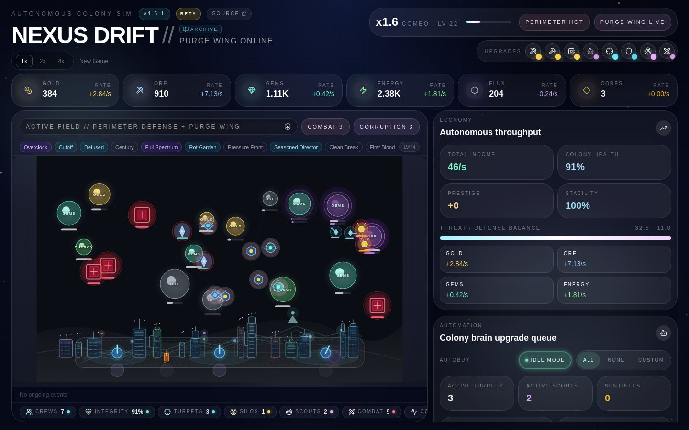

<p align="center">
  
</p>

<h1 align="center">Nexus Drift</h1>

<p align="center">
  <b>An idle sci-fi colony sim that runs in your browser.</b><br>
  Workers mine, silos and turrets hold the line, and you can step in and steer or just let it run.
</p>

<p align="center">
  <a href="https://mdbook.github.io/nexus-drift/">Play now</a> ·
  <a href="#quick-start">Quick start</a> ·
  <a href="#features">Features</a> ·
  <a href="docs/development.md">Development guide</a> ·
  <a href="PLAYER-GUIDE.md">Player guide</a> ·
  <a href="#docs">Docs</a>
</p>

<p align="center">
  <a href="LICENSE"></a>
  <a href="https://github.com/mdbook/nexus-drift/actions/workflows/pages.yml"></a>
  
  
</p>



Nexus Drift is a colony sim built with React, TypeScript and Vite. Your drones mine gold, ore and more on their own, missile silos open every fight at long range, turrets cover the perimeter, and scouts hunt corruption before it rots your economy. You are the colony's operator: buy upgrades, nudge workers, flag threats, inspect any unit. Or flip on Idle Mode and watch it play itself, even overnight. It runs entirely in the browser, with no server and no account.

## Quick start

The fastest way is to [play it online](https://mdbook.github.io/nexus-drift/). To run it yourself you need Node.js 20+ and Git.

```bash
git clone https://github.com/mdbook/nexus-drift
cd nexus-drift
npm ci
npm run dev
```

Open the URL Vite prints (normally http://localhost:5173). Saves live in your browser's local storage.

Prefer Docker? This builds the static site and serves it with Nginx:

```bash
docker compose up --build   # then open http://localhost:8080
```

New to the game? The [Player guide](PLAYER-GUIDE.md) explains the loop and how to steer your colony.

## Configuration

There is nothing to configure. The game has no config file and no environment variables for players. Balance lives in `src/game/balance.ts` if you want to tweak it, and the one build-time switch (`GITHUB_PAGES=true`, which sets the Vite base path for a subpath deploy) is covered in the [development guide](docs/development.md).

## Features

- **You run the colony.** Click-to-buy upgrades with tooltips that explain any gate, optional autobuy per tile, and soft guidance: click a node to nudge a worker, click an enemy to mark it a priority. Operator actions are free.
- **Idle at heart.** Idle Mode puts everything on autobuy and the colony runs hands-off. Long runs autosave every 30 seconds and pause while the tab is hidden.
- **Workers with personality.** Miners, runners and drones each have per-unit variance and class abilities (overclock, sprint burst, corruption scan).
- **Defense in layers.** Missile silos first, then turrets, scouts and sentinels, all of which can be broken and rebuilt.
- **A real enemy roster.** Rushers, brutes, sappers, blights, leeches, phantoms, zappers and late-game Void Wardens, each with its own AI behavior.
- **Events and achievements.** Seeded random events bend the economy, and there are 74 achievements across four rarity tiers.
- **Deterministic sim.** The simulation uses a seeded RNG and has a headless runner (`npm run sim`) for balance analysis.

The full list is in [docs/features.md](docs/features.md).

## Docs

- [PLAYER-GUIDE.md](PLAYER-GUIDE.md): a no-spoilers guide to playing
- [docs/features.md](docs/features.md): everything the game does, by area
- [docs/development.md](docs/development.md): scripts, tests, the sim harness, Docker, CI
- [docs/architecture.md](docs/architecture.md): a map of the source tree
- [docs/known-work.md](docs/known-work.md): deferred follow-ups
- [docs/agent/INDEX.md](docs/agent/INDEX.md): detailed per-system notes (workers, economy, enemies, persistence, layout)

## Contributing

See [CONTRIBUTING.md](CONTRIBUTING.md). Short version: `npm ci`, make your change, and make sure `npm run typecheck`, `npm run lint`, `npm run format:check` and `npm test` pass.

## License

Nexus Drift is released under the GNU General Public License v3.0 or later (GPL-3.0-or-later), see [LICENSE](LICENSE).
